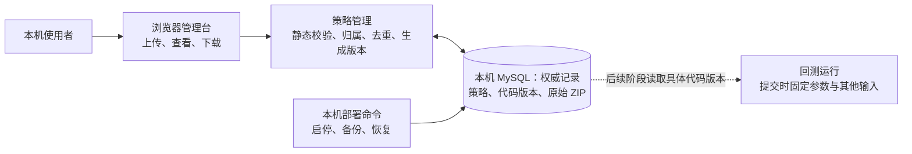

# 架构设计简报：本地平台与策略管理

- 需求编号：REQ-001
- 状态：已确认；阶段一实现与验证范围见测试报告
- 依据：[PRD](./prd.md) · [技术方案](./technical-design.md)

## 结论

阶段一只建立一条本机策略代码管理链路：使用者上传或查看策略包；策略管理负责校验、归属和版本决定；本机 MySQL 保存策略、不可变代码版本及原始包。参数定义随代码版本保存，用户填写的参数值等到提交回测时才固定。

图中的“策略管理”“回测运行”表示职责，不要求各自成为独立服务。虚线是后续阶段的衔接点；阶段一不运行策略。

## 正常流程

使用者在浏览器选择“上传新策略”或从已有策略选择“上传新版本”，提交 ZIP。策略管理只做静态检查，并根据包内名称确认归属；校验通过后，一次性保存策略或新代码版本及原始包。保存成功才显示“已导入，未运行验证”。查看版本时，页面从该版本的声明展示参数定义，下载时返回保存的原始包。

## 三项职责决定

1. **归属和编号由策略管理决定。** 策略是长期归类；代码版本是不可修改的具体包。页面不根据文件名推断归属，也不自行分配版本号。
2. **代码版本是阶段一的最小可追溯单位。** 参数定义属于代码版本；参数值只是未来一次运行的输入。阶段一不建立参数配置或修订记录。
3. **本机 MySQL 是权威来源。** 策略、版本及原始 ZIP 一同持久保存；备份与恢复由本机部署命令负责，不通过管理台操作。

## 失败时先看哪里

- 包损坏、名称不符、重名或重复：先看上传反馈；失败不留下半条记录。
- 页面无法读取记录或下载原包：先看应用状态和数据库状态；未确认保存成功时，不显示导入成功。
- 备份或恢复失败：先核对导出文件与隔离恢复结果；未通过核对的备份不能用于恢复。

上传成功只证明包的结构和声明通过静态校验。运行依赖是否齐全、策略是否能产生正确结果，留到回测阶段验证。
