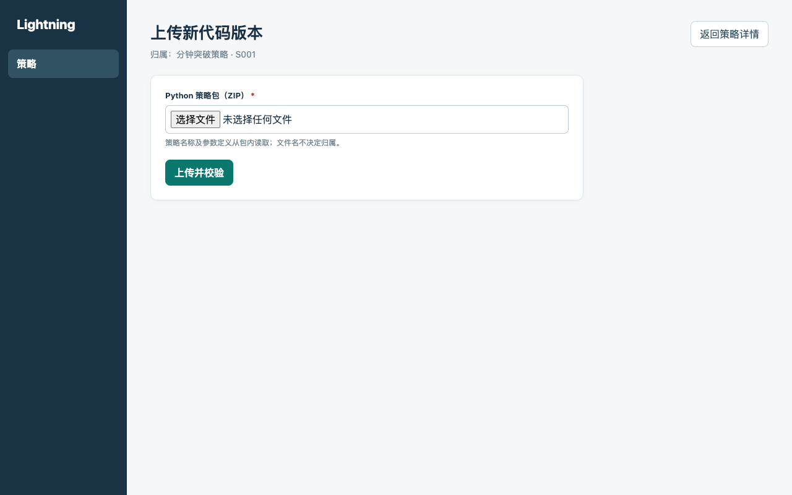

# PRD：本地平台与策略管理

- 需求编号：REQ-001
- 状态：草稿，待评审
- 需求索引：[README.md](./README.md)
- 所属阶段：[Roadmap 阶段一](../../product/roadmap.md)

## 1. 需求背景

当前先在一台 Apple Silicon Mac 上完成量化平台。使用者需要通过本机浏览器上传、查找和复用 Python 策略代码，并在以后回测时准确找到当时使用的代码。

阶段一只交付本地策略代码管理：用 Docker 启动管理台，保存原始代码包和不可覆盖的代码版本，展示每个版本声明的参数。本阶段不运行策略，也不保存用户试填的参数。服务器部署、多人权限、行情、回测、模拟和实盘交易均不在本阶段。

## 2. 需求术语

| 术语 | 含义 |
| --- | --- |
| 策略 | 对同一交易思路的长期归类，由平台分配稳定标识和名称。策略下面可以有多个代码版本；策略本身不能直接运行。 |
| 策略包 | 开发者上传的 ZIP 文件，包含策略说明、Python 代码、参数定义和运行依赖。文件名不决定它属于哪个策略。 |
| 代码版本 | 一次成功上传后保存的原始策略包及其声明，固定归属一个策略，保存后不可修改。以后运行时选择具体版本。 |
| 参数定义 | 某个代码版本声明的参数名称、类型、必填规则、默认值及适用的范围或选项；不同版本可以不同。 |
| 参数值 | 用户为一次运行填写的具体值。阶段一不保存；提交回测时才与代码及其他输入一同固定。 |

## 3. 需求详述

以下原型图展示页面入口与反馈；策略包校验以文字规则为准。可点击的完整流程见 [HTML 原型](./prototype.html)。

### 3.1 策略列表与新建入口

`R-02` 空数据时显示上传入口；已有数据按“策略 → 代码版本”查看。列表展示策略名称和版本数量，进入策略后可选择具体版本。

### 3.2 新建策略

`R-03` 使用者选择“上传新策略”，提交 ZIP 策略包。包内至少有名称与说明、适用市场和分钟级行情及所需数据、Python 代码入口、运行依赖和参数定义。首期支持 A 股、美股；参数支持整数、小数、布尔值、文本、枚举，可声明必填、默认值及适用的范围或选项。不将券商密码或密钥作为策略参数。

系统只检查包的结构和声明，不执行策略代码。损坏、缺内容、声明无效或超出支持范围时，说明原因且不留下记录。校验通过后，保存原始 ZIP、上传时间、文件校验值，创建策略及首个代码版本，并显示“已导入，未运行验证”。

`R-10` 平台为新策略生成稳定标识。包内名称与已有策略重名时，不创建新策略，提示从已有策略上传新版本。

### 3.3 上传与查看代码版本

`R-04` 使用者从已有策略进入“上传新版本”。包内名称必须与该策略一致，否则拒绝。新内容生成新版本，旧版本不可覆盖；同一策略重复上传完全相同的原始 ZIP 时，提示已有版本，不新增记录。

`R-05` 版本详情显示该版本的参数定义，包括名称、类型、必填规则、默认值、适用范围或选项。切换版本时，显示对应版本的定义；没有可调整参数时显示明确的空状态。

`R-07` 版本详情显示所属策略、上传时间、文件校验值和“已导入，未运行验证”状态，并提供原始包下载。上传成功只表示静态校验通过，不表示代码可运行。

`R-06` 阶段一不提供填写或保存参数值的操作，也不生成配置修订记录。

### 3.4 本机使用与数据保护

| 编号 | 需求与验收 |
| --- | --- |
| `R-01` | 本机可启动、停止和重启；本机浏览器可访问，其他设备不能直接访问；启动失败能找到原因。 |
| `R-08` | 重启后，策略、版本、原始包、参数定义及其关联不变。 |
| `R-11` | 可将数据备份到 Docker 数据卷之外，在隔离环境恢复，并核对记录数量、稳定标识、关联和原包校验值。 |
| `R-12` | 本机数据与未来服务器数据隔离；准备好所需镜像后，断开公网仍可启动、上传和查看。 |

### 3.5 与后续阶段的衔接

提交回测时，按所选代码版本的定义填写并校验参数，在启动前固定代码、完整参数、数据版本等运行输入。每次回测保留自己的输入和结果；同一组参数可用于多次回测。以后模拟和实盘也保留各自启动时的输入。参数填写界面及运行接口在回测阶段确定。

本机备份若与数据卷位于同一块磁盘，无法防范整机或磁盘损坏。自动备份留到 Roadmap 阶段五；服务器部署待本机产品完成后另行评估。

项目尚未上线。阶段一按全新安装验收，不要求旧数据迁移、旧版本兼容或跨版本升级回退。
