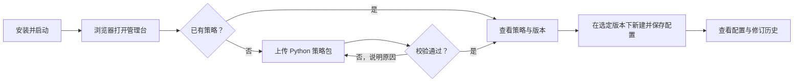
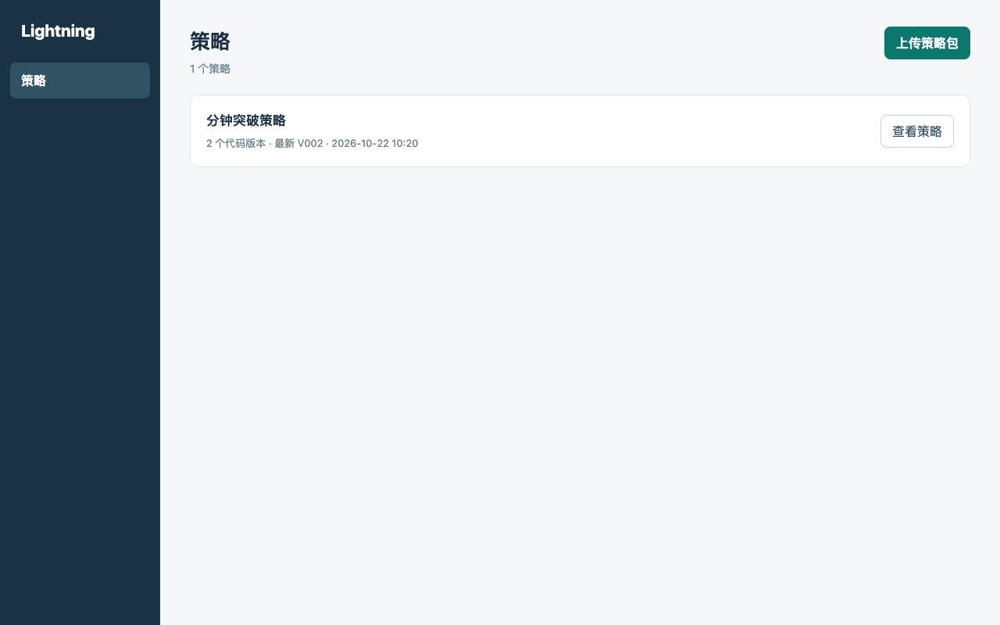
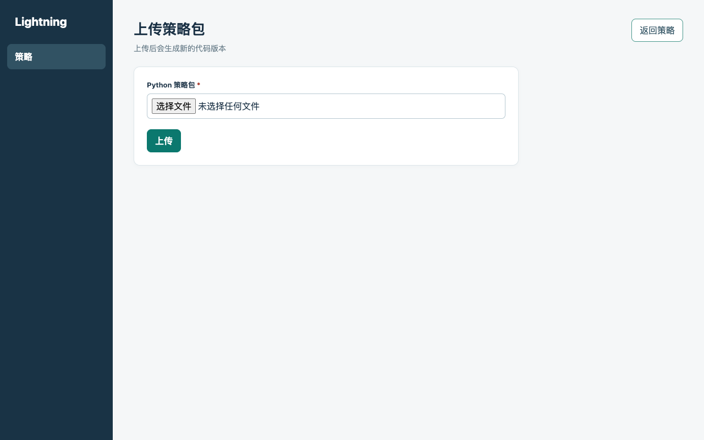
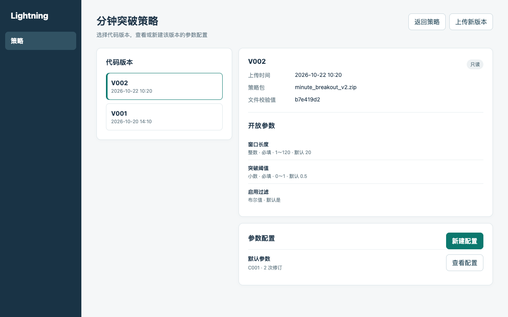
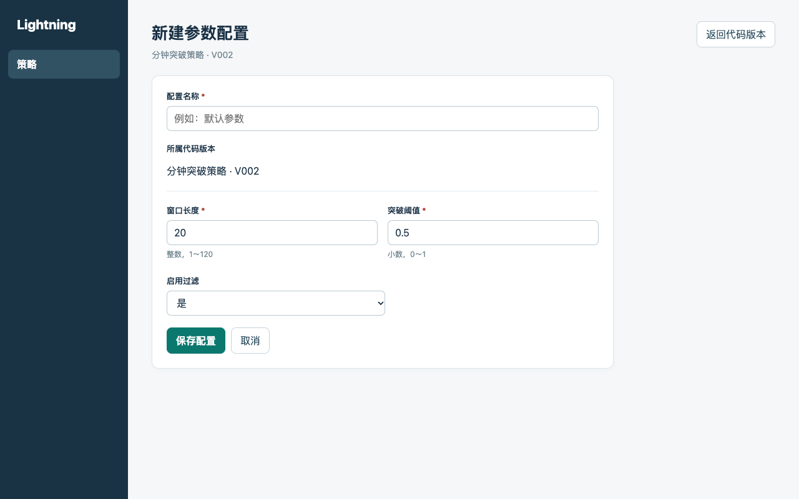
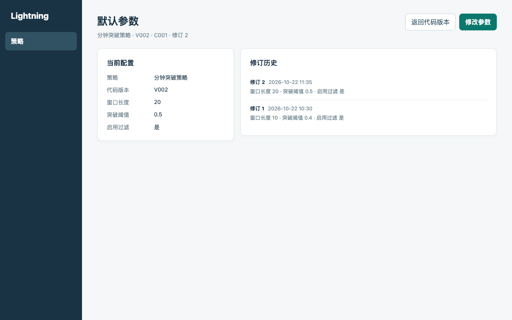

# PRD：macOS 平台与策略管理

- 需求编号：REQ-001
- 状态：草稿，待确认
- 需求索引：[README.md](./README.md)
- 所属阶段：[Roadmap 阶段一：macOS 平台与策略](../../product/roadmap.md)

## 1. 背景与目标

- Roadmap 阶段一要交付可安装、可启动的本地管理台，并让策略版本和参数配置在重启、升级后仍可追溯。
- 开发者上传 Python 策略包；内部使用者查看版本、填写参数并保存配置。两者可以是同一人。
- 目标是为后续回测、模拟和实盘留下确定的策略版本和参数值；这些运行都应能追溯到同一份代码和配置。本阶段不运行策略。

## 2. 本次范围

- 本次做：在 macOS 本机安装所需组件并启动，通过浏览器管理策略包版本和参数配置；升级后仍能读取已有数据。
- 暂不做：备份与恢复、服务器部署、行情、策略运行、回测、模拟及实盘交易、账户和报表。已保存不等于已运行验证。
- 首期只在当前这台 Apple Silicon Mac 上验收。策略声明的市场限 A 股、美股，行情周期限分钟级。参数支持整数、小数、布尔值、文本、枚举，以及必填、默认值和数值范围。不保存券商密码或密钥作为策略参数。

### 策略包的最低内容

策略包是开发者上传的 ZIP 文件，至少包含：

- **基本描述**：策略名称和简短说明。
- **适用数据**：面向的市场、行情周期及所需数据。
- **代码实现**：Python 源代码和可识别的策略入口。后续回测、模拟和实盘向策略提供统一格式的行情与只读账户状态；策略输出目标持仓，由平台处理风控、下单和记录。
- **参数定义**：每个可调整参数的名称、类型、是否必填、默认值（若有）；适用时还要写明数值范围或枚举选项。
- **运行依赖**：声明代码需要的 Python 运行环境和外部依赖，便于后续复现与迁移。

用户填写的具体参数值另存为配置，不写回策略包。阶段一只检查包的结构和声明，不运行代码；具体函数签名留待技术方案确定。

## 3. 流程与原型

可点击的 [HTML 页面原型](./prototype.html) 展示主要操作。下表右侧是对应页面的截图；具体规则和异常以文字需求为准。

## 4. 需求与验收

| 页面 | 需求与验收 | 原型截图 |
| --- | --- | --- |
| 策略列表 | `R-01` 在当前验收设备安装、启动和关闭；浏览器能打开管理台，失败时能找到原因。验收：安装、关闭、重启及模拟失败。  `R-02` 空数据有上传入口；已有数据按“策略 → 代码版本 → 参数配置”查看。验收：查看空数据、多个策略及不同版本下的配置。  `R-08` 重启后记录和关联不变。`R-09` 升级后仍可读取；升级失败不破坏已有数据，并说明回退步骤。验收：重启、升级和模拟升级失败后核对数据。 |  |
| 上传策略包 | `R-03` 包须可读取，且具备上述内容；声明缺失、无效或超出支持范围时说明原因，不保存。成功后保存原始包、时间、唯一版本号及文件校验值，并显示“已导入，未运行验证”。验收：上传有效、损坏、缺内容、无效声明和不受支持的包，核对记录与提示。 |  |
| 策略版本 | `R-04` 在已有策略下上传新内容时生成新版本；旧版本不可覆盖，重复包提示已有版本。验收：上传相同包和改动后的包，核对版本及原始包。  `R-10` 新策略由平台生成稳定标识；新策略名称与已有策略重名时不创建，并提示使用已有策略入口；在已有策略下上传的包若名称不一致则拒绝。文件名不决定策略归属。验收：分别尝试重名、名称不一致和正常上传。 |  |
| 新建或修改配置 | `R-05` 从代码版本下新建配置，显示所属策略和版本，按该版本校验必填、类型、默认值、枚举和数值范围；错误时不保存并保留输入。验收：从不同版本进入，填写有效和无效值。 |  |
| 配置详情 | `R-06` 配置固定关联创建时的策略版本；每次保存生成不可变的修订标识，保留当时的名称、参数值和时间。后续运行须引用确切的策略版本与配置修订，修改配置不影响已有运行。验收：修改名称和参数，核对新旧修订及固定关联。  `R-07` 可从配置查到策略和版本；上传成功不表示可运行，未运行的版本显示“未运行验证”。验收：查看配置来源和版本状态。 |  |

## 5. 风险与待确认

- 策略包的文件与字段已由技术方案定义；行情调整、账户币种和目标仓位约束等运行细节留到回测阶段确定，不得改变已固定的接口含义。
- 其他 Mac 的兼容性未验证；升级路径和回退步骤待首个可升级版本确定。
