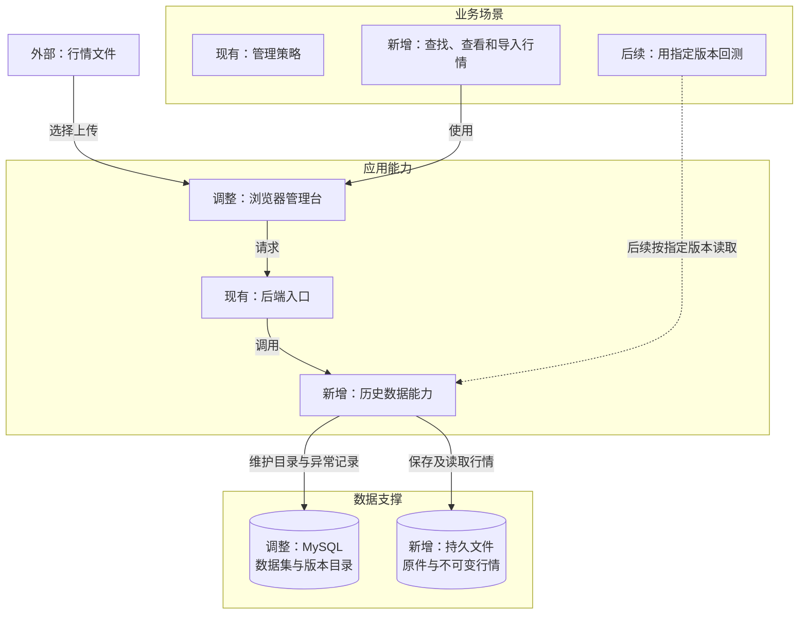
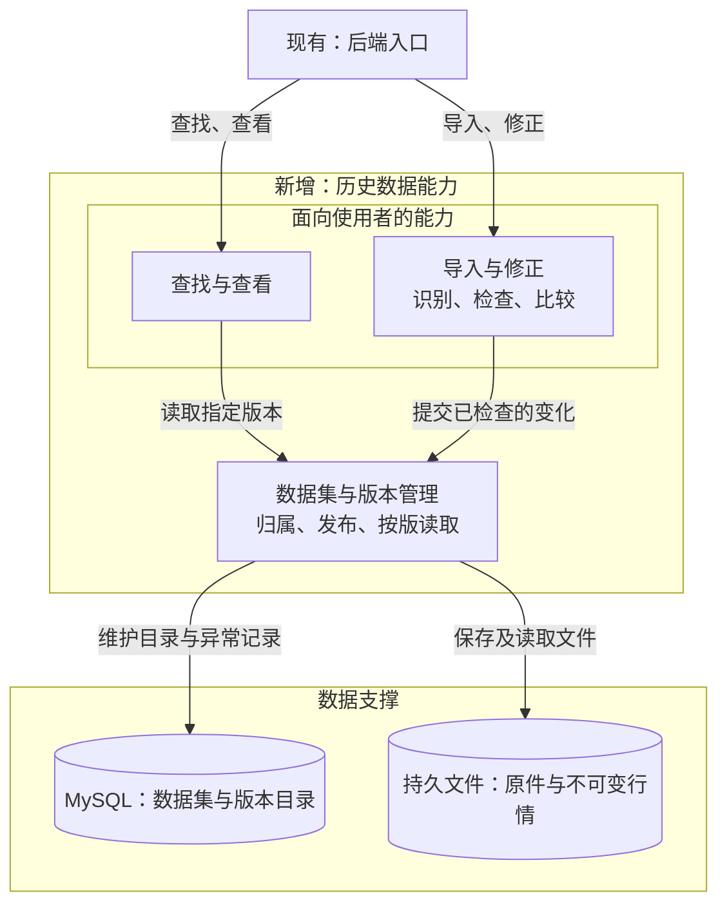

# 架构设计：历史数据

- 需求编号：REQ-002
- 状态：修订草稿，待按新版 PRD 确认
- 依据：[PRD](./prd.md) · [交互原型](./prototype.html)

## 结论与整体架构图

在现有本机管理台和后端增加历史数据能力，让使用者查找、查看和导入日线或 1 分钟行情；后端维护数据集和不可变版本，供后续回测固定引用。

**权威数据**由 MySQL 中的版本目录和其指向的不可变行情文件共同构成。目录或文件不完整时，该版本不能对外可读。策略管理是同层现有能力，不因本需求改变；回测只表示后续衔接。备份与恢复的关系见下表。

## 融入现有体系

| 位置 | 融入关系 | 边界 |
| --- | --- | --- |
| 浏览器管理台 | 沿用现有入口，增加历史数据查找、K 线和导入页面。 | 展示结果、收集无法可靠判断的信息；不自行决定数据集归属或版本。 |
| 后端入口 | 沿用现有请求入口，接入历史数据能力。 | 策略管理保持原职责；历史数据决定归属、检查结果和版本发布。 |
| 本机存储 | 沿用 MySQL，新增持久文件存储。 | MySQL 维护来源、数据集、版本目录和异常记录；文件保存原件与行情，两者共同支撑读取。 |
| 备份与恢复 | 扩展现有本机命令，覆盖数据库与文件。 | 两部分来自同一次备份，隔离恢复并核对后才能开放读取。 |
| 后续回测 | 通过历史数据能力按指定版本取数。 | 本阶段只保留稳定引用；选择页面和阻止规则由 REQ-003 定。 |

数据集按同一来源、市场、行情周期、价格处理方式和交易时段归类；股票和日期是覆盖范围。一次有效导入若改变内容，就产生该数据集的完整新版；旧版不变。不同来源的行情不自动合并。

## 功能架构图

下面放大整体图中的“历史数据能力”。各框表示职责，未要求拆成独立进程或服务。

查询与导入共用同一套数据集归属和版本目录。页面上的“无行情”来自当前范围内没有已保存记录；“数据异常提示”来自该版本记录的观察结果。两者都不自动判定数据是否适合回测。

## 关键决定与运行边界

| 事项 | 决定或责任 | 异常与待验证点 |
| --- | --- | --- |
| 导入归属 | 后端按来源及行情口径归类；不能可靠判断的内容请使用者确认。 | 文件与目标数据集不符时，不混入原数据集。 |
| 数据检查 | 无效记录阻止导入；价格或成交量的可疑变化仅形成该版本的异常提示。 | 没有可靠交易日历或停牌依据时，不推断缺口数量，也不自动补价。 |
| 版本发布 | 内容相同不生成新版；新增记录可发布；改动旧值须先核对差异。 | 中断或发布失败不暴露半个版本，旧版继续可读。 |
| 数据保护 | 后端维护目录与文件的对应关系；备份命令联合保存，隔离恢复后核对。 | 文件损坏或缺失时阻止读取该版本并定位问题；恢复未通过核对时不开放读取。 |
| 首批输入 | 用实际文件确认来源、格式、市场时间、价格处理方式和规模。 | 未验证前，不承诺自动识别范围、容量上限或行情完整性。 |

本阶段不增加数据权限管理或人工核实任务。若首批来源有明确使用限制，再依据事实确定处理规则。
