# PRD：历史数据

- 需求编号：REQ-002
- 状态：草稿，待评审
- 需求索引：[README.md](./README.md)
- 所属阶段：[Roadmap 阶段二](../../product/roadmap.md)

## 1. 需求背景

**目标：让准备回测的人找到所需股票的历史行情，看清具体价格和异常提示；缺数据时能导入，并能固定使用的版本。**

| 场景 | 使用者要做什么 | 完成后得到什么 |
| --- | --- | --- |
| 按日或按周决策 | 查找目标股票的日线，查看所需日期。 | 知道哪些日期有行情、价格是多少。 |
| 按盘中价格决策 | 查找 1 分钟线，进入某日的盘中时段。 | 知道该时段保存了哪些分钟行情。 |
| 补充或修正行情 | 上传文件；若会改动旧值，先核对差异。 | 得到新版，旧版保持不变。 |

本阶段支持本机浏览器中的 A 股、美股常规交易时段的日线和 1 分钟线。交易频率不直接决定行情周期：即使交易很少，只要策略依赖盘中价格，也需要分钟线。回测运行、实时行情和高频数据不在本阶段。

## 2. 需求术语

| 术语 | 含义 |
| --- | --- |
| 行情周期 | 一条行情覆盖多久。日线是一交易日一条；1 分钟线是一分钟一条。 |
| 数据来源 | 提供方及其数据产品，或自有采集方式；不等于上传文件名。 |
| 数据集 | 来源、市场、周期、价格处理方式和交易时段相同的一组行情。股票和日期可不断增加。 |
| 导入记录 | 一次成功导入的文件和时间；这次导入产生一个新版本。 |
| 数据版本 | 一次导入完成后，数据集当时的全部行情。新版产生后，旧版内容不变。 |
| 异常提示 | 价格或成交量有值得注意的变化。它提示使用者留意，不代表数据已判错，也不产生核实任务。 |
| K 线图 | 每根 K 线显示一天或一分钟的开盘、最高、最低、收盘价；下方显示成交量。缩放只改变可见范围，不改变一根 K 线代表的时间。 |

例如，提供方 A 的 A 股日线是一个数据集。第一次导入贵州茅台 1 月行情，得到版本 1；补充 2 月后，版本 2 包含两个月，版本 1 仍只有 1 月。该提供方的分钟线属于另一个数据集。回测引用具体版本。

| 数据集归类条件 | 用户需要知道什么 |
| --- | --- |
| 来源 | 不同提供方或产品的行情不自动混合。 |
| 市场和股票所属交易所 | 市场如 A 股、美股；每只股票还需明确交易所。 |
| 行情周期 | 日线和 1 分钟线分开保存。 |
| 价格处理方式 | 是否因分红、拆股调整价格；如已调整，还要记下计算方法和参照日期。 |
| 交易时段 | 本阶段只收常规交易时段；盘前盘后不能混入。 |

每条行情还需有股票、交易日期或分钟时间、开高低收价和成交量。分钟文件需说明时区、时间代表这一分钟的开始还是结束，以及成交量单位。**股票和日期决定一个版本覆盖哪里，不决定数据集归属。**

## 3. 需求详述

先查找，再看 K 线；缺少时导入。系统处理文件识别、时间换算和版本生成，只请使用者决定无法可靠判断的内容。

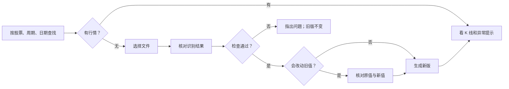

### 交互设计步骤 1～3：任务、页面与重点

任务和场景见第 1 节。页面按“查找 → 查看 → 必要时导入”划分：

| 页面或状态 | 主内容 | 主操作与去向 |
| --- | --- | --- |
| 查找 | 可选择或输入的股票、周期、日期和匹配结果 | 查找；有结果时查看行情 |
| 从未导入 | 尚无行情 | 导入文件 |
| 无匹配来源 | 所查股票和周期没有来源 | 导入文件 |
| 来源存在、日期无行情 | 来源与所选日期的结果 | 补充文件；也可换日期 |
| K 线详情 | K 线、成交量和当前时点的数值 | 浏览范围、查看时点；需要时切换版本或补充 |
| 选择文件 | 文件选择 | 选文件后自动读取 |
| 核对导入 | 文件摘要与待确认项 | 检查并导入 |
| 修正确认 | 将被改动的原值、新值 | 确认修正 |
| 导入失败 | 文件行号、字段和原因 | 修改文件后重选 |
| 没有新行情 | 文件内容与现有版本相同 | 查看已有 K 线；不生成新版 |
| 导入完成 | 新版本及本次变化 | 查看新版 K 线；多股票时先选股票 |

### 交互设计步骤 4：逐点筛选

以下是默认页和关键状态的取舍。原型中新出现的点按同样问题复核：谁现在需要、帮助做什么、系统能否处理、不展示有何影响。

| 页面或状态 | 交互点 | 必要性 | 处理方式 |
| --- | --- | --- | --- |
| 查找 | 股票选择框 | 减少记代码和输错交易所 | 点开看当前周期已保存的股票；输入代码筛选，也可直接输入未保存的代码 |
| 查找 | 周期、日期 | 决定查什么行情 | 默认显示；市场能从股票可靠判断时不再询问 |
| 查找 | 分钟起止时间 | 查找阶段不需要逐分钟筛选 | 移到分钟 K 线详情的时段选择 |
| 结果 | 来源、价格处理、已保存日期 | 帮助选数据；不能推断完整性 | 分开显示；无可靠交易日历时不写“应有几条” |
| 结果 | 异常提示 | 有异常时影响判断 | 只在实际存在时显示；原因点选图上标记再看 |
| K 线 | 逐条行情表 | 点选 K 线已能看到相同数值 | 删除重复表格 |
| K 线 | 范围滑杆 | 长区间需要定位和缩放；短区间不需要 | 超出一屏时显示；拖动中间移动，两端缩放，不合并行情 |
| K 线 | 十字定位与选中标记 | 需要知道读数对应哪根 K 线 | 移入时临时定位，点击后固定；整根轻描边，不加额外数据点 |
| K 线 | 版本和文件来历 | 需要追溯时才看 | 版本可切换；文件放入折叠的“导入记录” |
| 导入 | 文件格式、校验值 | 格式帮助可按需看；校验值不帮助当前操作 | 样本折叠；校验值留系统内部 |
| 核对导入 | 来源、价格处理、单位、分钟时间含义 | 仅在文件无法可靠判断时由人确认 | 不预选；已确定的内容只展示结果 |
| 修正、完成 | 差异与版本变化 | 决定是否覆盖旧值、是否继续查看 | 修正差异直接可见；完成只显示实际变化 |

步骤 5 的结果是[可操作原型](./prototype.html)和各需求旁的截图。原型的行情、交易日和异常均为演示数据；刷新后上传结果会重置。

### 3.1 查找与查看行情

`R-01` 使用者按股票、周期和日期查找。点开股票框，显示当前周期已保存的股票候选；输入代码可筛选。候选显示代码和交易所，同一股票跨来源只列一次。选中候选后，按其交易所查找。手动改代码时清除原选择，未保存的代码也能查找。没有匹配候选或候选读取失败时，仍可直接输入代码。切换周期时保留股票和日期，并更新候选。

系统能可靠识别股票所属市场时自动处理；不能识别时才询问。结果按来源分开，显示价格处理方式、已保存行情的日期范围；有异常才提示。没有可靠交易日历时，不显示“应有多少条”或缺口数量。

空结果按原因给下一步：无来源可导入；来源存在但所选日期无行情可补充；周末等确定的非交易时间先建议换日期，不引导补缺。不能确定是否休市时，只说“所选日期没有行情”。

验收：选择已保存股票可准确带入代码和交易所；输入代码能筛选候选，未保存代码也能查找；切换周期后候选更新、已填股票保留。日线和分钟线不会混用；查找默认无分钟起止时间；结果不把“未保存”写成“数据缺失”。

日线查找：

<a href="./figures/req2-list.png">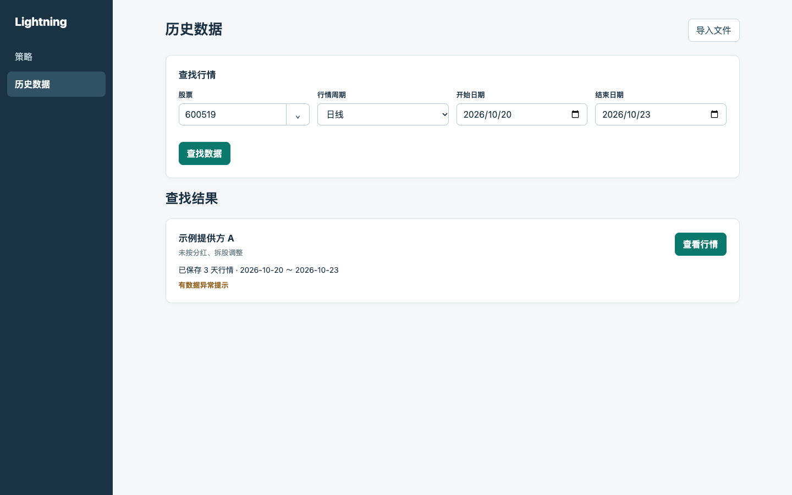</a>

股票下拉：[试用原型](./prototype.html)；[候选读取失败时的反馈](./prototype.html?demo=stock-error)。

<a href="./figures/req2-stock-picker.png">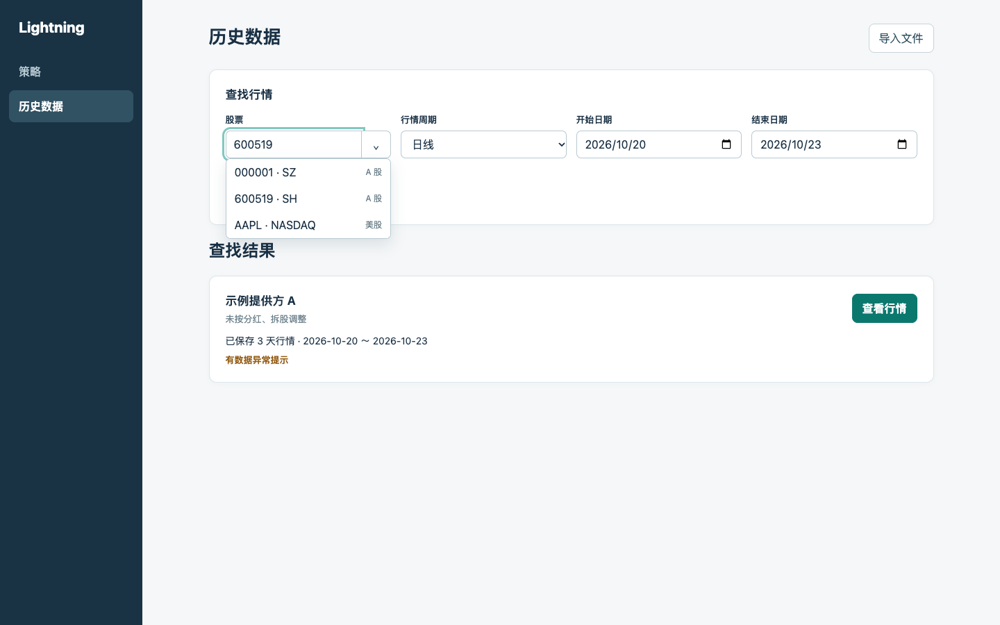</a>

分钟线查找：

<a href="./figures/req2-minute-search.png">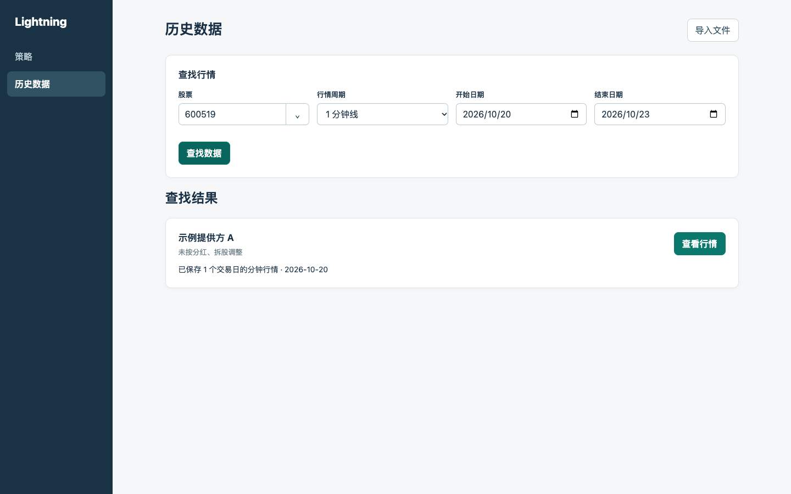</a>

| 空状态 | 原型对照 |
| --- | --- |
| 从未导入 | <a href="./figures/req2-empty.png">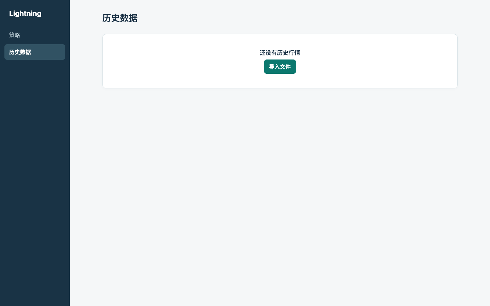</a> |
| 无匹配来源 | <a href="./figures/req2-no-source.png">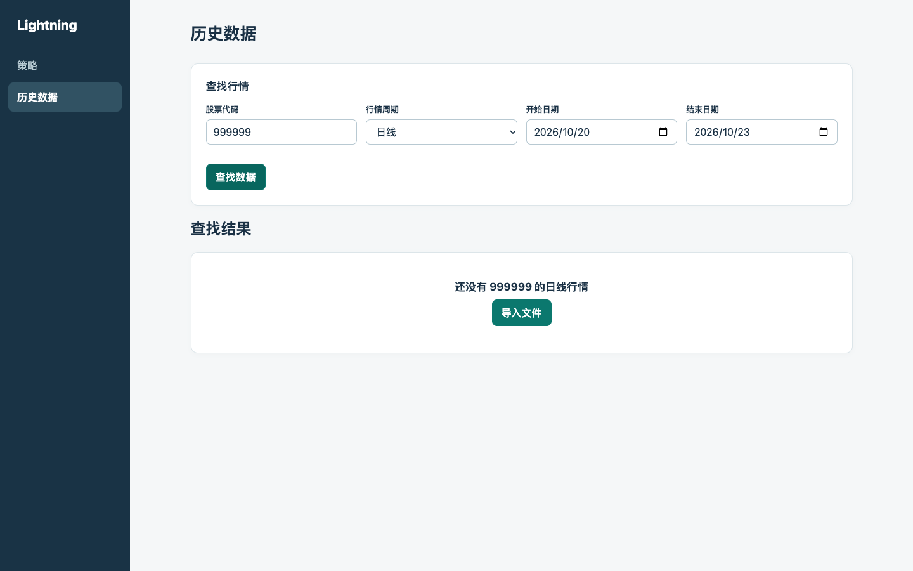</a> |
| 来源存在、日期无行情 | <a href="./figures/req2-no-range.png">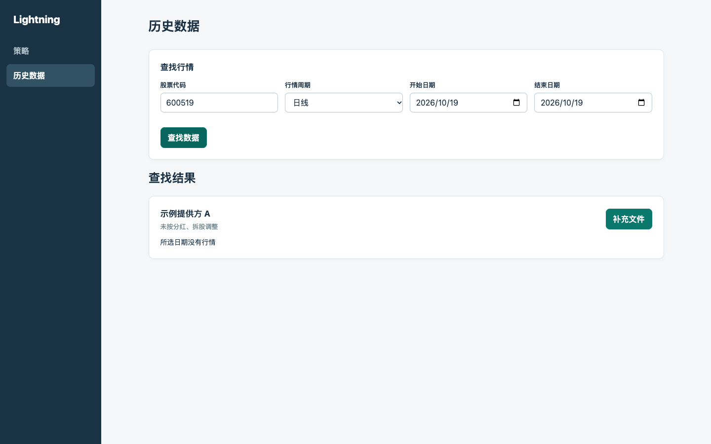</a> |

`R-02` 详情默认打开所查股票、日期和最新版，以 K 线和成交量为主。数据少时显示全部；超出一屏时默认显示所查范围内最近一段，并在图下显示范围滑杆。拖动滑杆中间可看前后行情，拖动两端可缩放；图表随拖动更新。放大、缩小都以 K 线仍可读为限；更长的范围通过移动滑杆浏览。缩放不合并行情，日线仍是一日一根，分钟线仍是一分钟一根。

首次打开时，图上的定位标记和数值都指向可见的最后一根 K 线。移入其他 K 线时，细竖线和数值临时跟随；点击后固定在该根 K 线上，整根 K 线轻描边，不另加圆点。点击图表空白处可取消固定。移动可见范围后，若原选中时点仍可见就保持；否则定位到新范围内最后一根。数值包含时间、开、高、低、收价及成交量。

无行情的时间中性留空；异常记录用另一种标记，点选后说明观察到的变化。分钟线先选日期，再按需选盘中时段。切换旧版后，图和异常提示都显示该版内容；范围和定位按该版行情重新确定。

“导入记录”按需展开，只显示来源全称、版本承接关系、相关文件和导入时间；不重复 K 线数值，不列其他股票，也不展示校验值。

验收：长区间可用滑杆连续移动和缩放，短区间不出现多余滑杆；缩放前后同一根 K 线的数值不变；图上定位与读数一致；旧版内容不受新导入影响；无行情与异常的视觉含义不同。

<a href="./figures/req2-detail.png">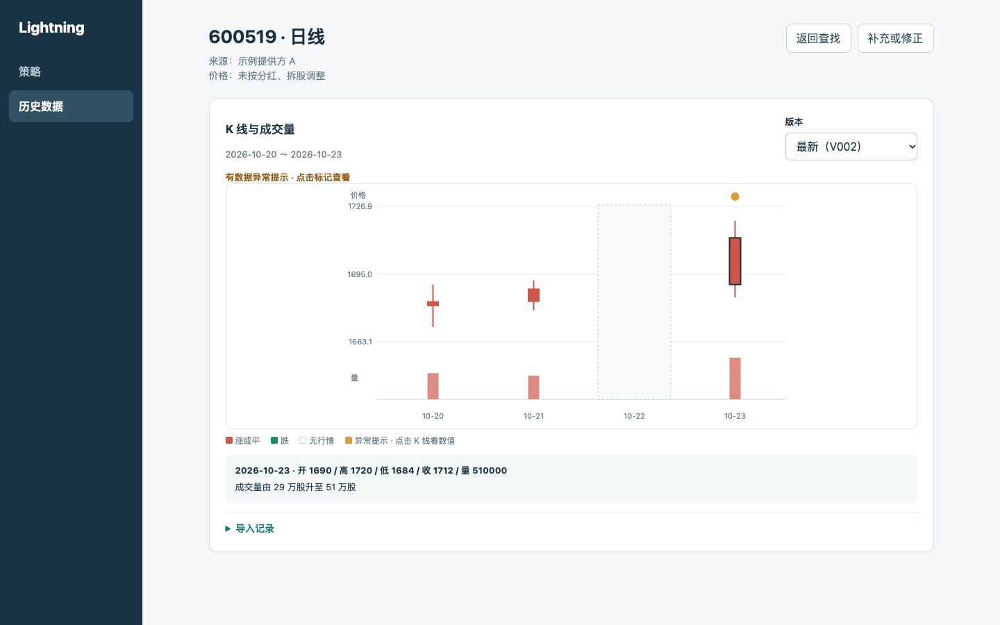</a>

<a href="./figures/req2-minute-detail.png">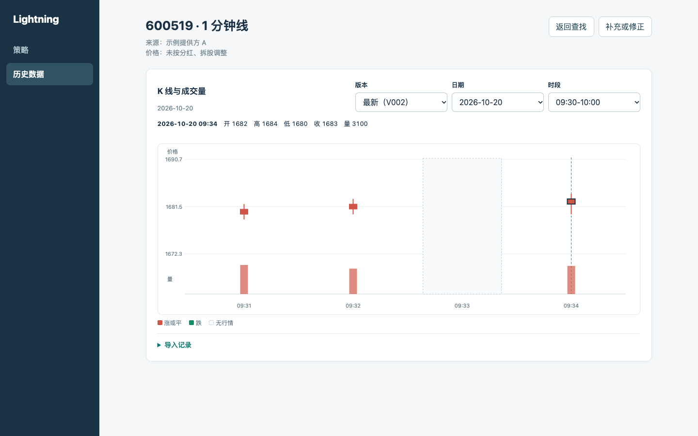</a>

长区间滑杆：[试用原型](./prototype.html?demo=range)。该入口使用模拟行情，仅演示滑杆操作。

<a href="./figures/req2-range.png">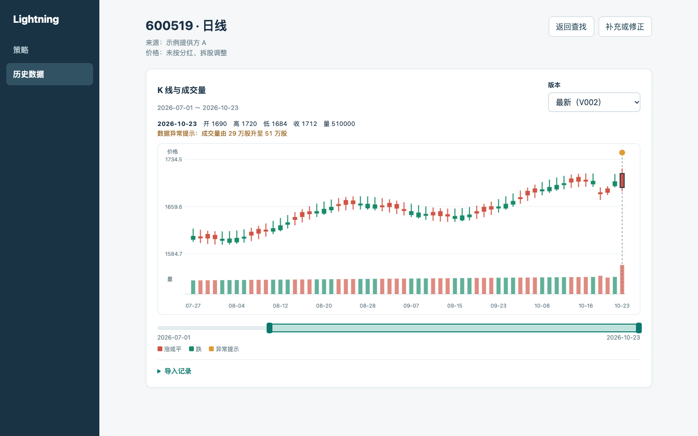</a>

### 3.2 导入、补充和修正

`R-03` 选文件后自动读取。系统把支持的文件整理成统一行情，展示文件、股票、行数和时间范围。已有目标数据集时保持归属；从查找页导入时需明确选择已有来源或新来源。价格处理方式不能凭空预选。成交量单位和分钟时间含义无法可靠识别时，由使用者确认。保存前显示一分钟时间换算后的市场时间示例。

若文件与当前目标的市场或周期不同，保留已选文件，说明差异，并允许按文件另行导入。无法可靠分组的混合文件不静默合并，应说明问题。验收：错误归属不会生成版本；时间换算结果可在提交前看到。

<a href="./figures/req2-file.png">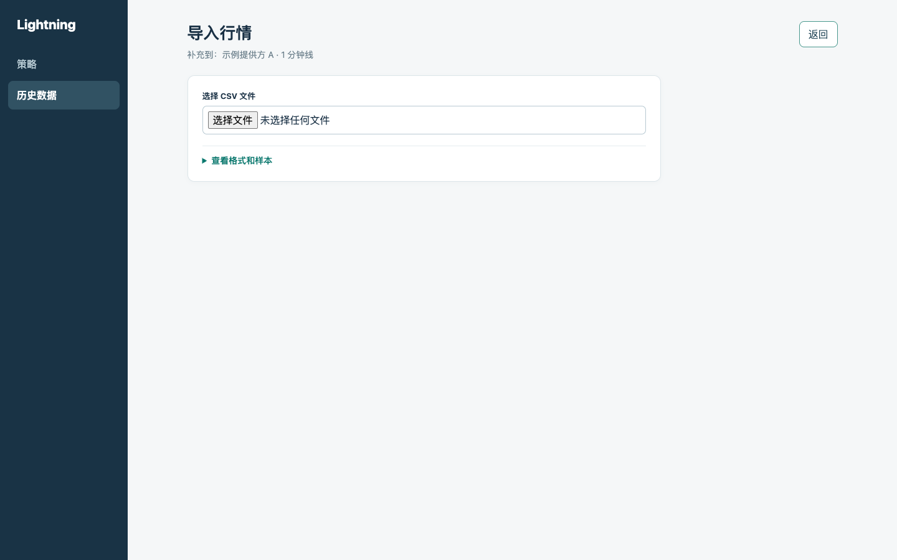</a>

<a href="./figures/req2-upload.png">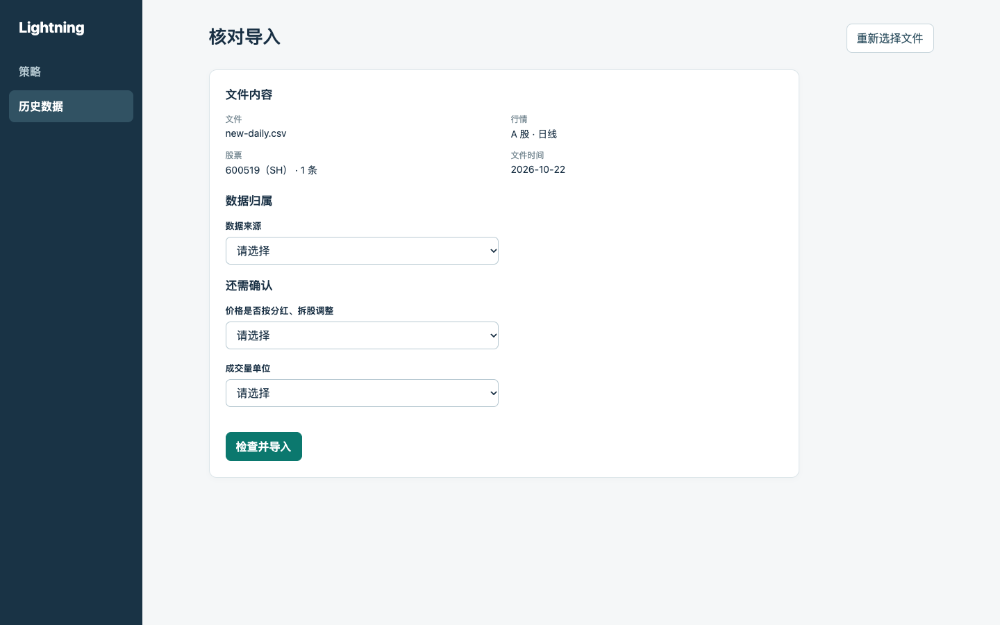</a>

<a href="./figures/req2-minute-upload.png">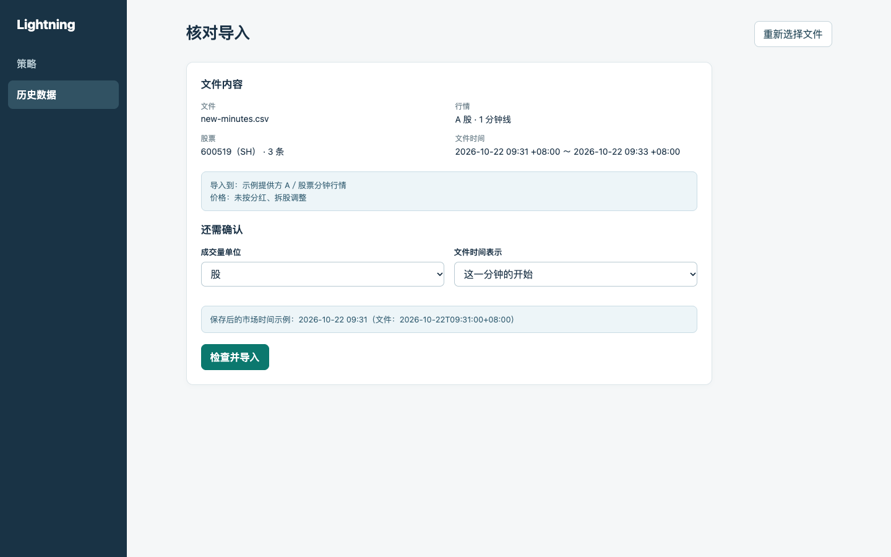</a>

`R-04` 只增加新记录时直接生成新版。文件与最新版内容完全相同，不生成新版本，并明确告知。导入完成页显示新版、本次新增或修正的数量及日期范围；涉及多只股票时，先选要查看的股票，不替使用者任选一只。

验收：成功后可打开所选股票的新版 K 线；重复内容返回现有版本。

<a href="./figures/req2-success.png">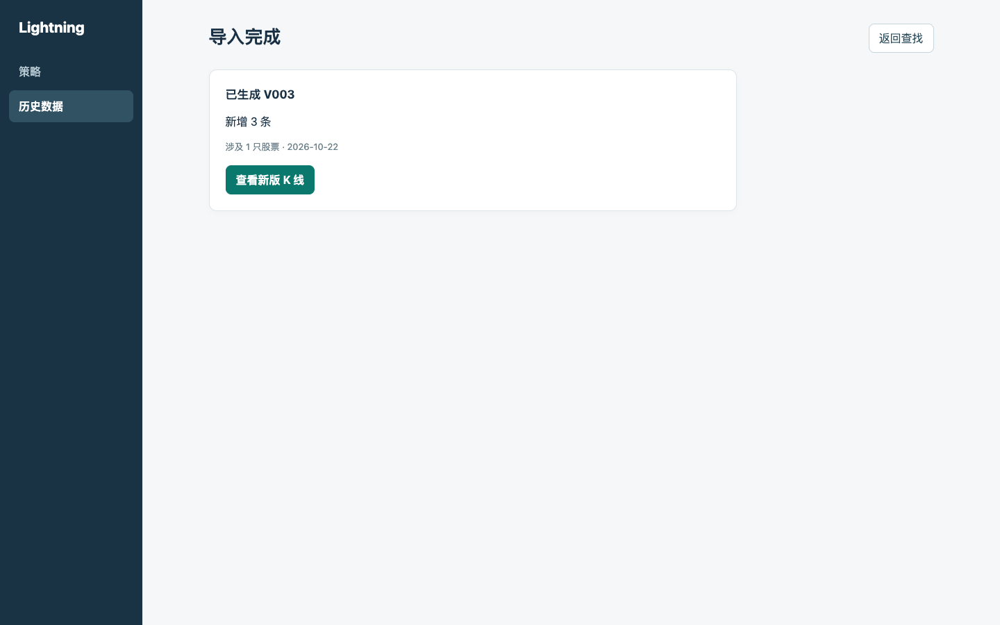</a>

`R-05` 改动已有价格或成交量前，显示原值、新值和影响范围，让使用者确认。若同时增加记录，另说明新增数量和日期范围；差异很多时分页查看。取消、失败或中断都不得留下部分导入的版本。

验收：可核对每个变化项；取消后旧版仍可读取。

<a href="./figures/req2-review.png">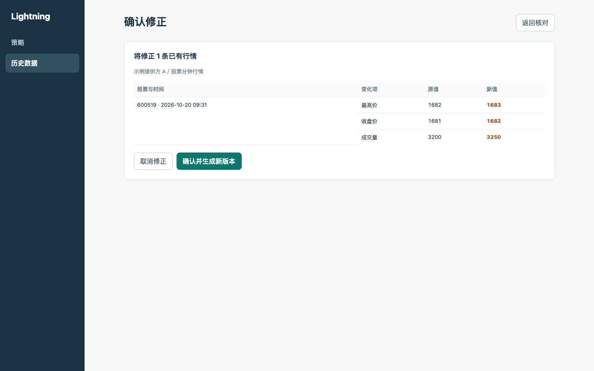</a>

### 3.3 数据检查与异常提示

**无行情**表示当前范围没有保存记录；**异常提示**表示观察到值得注意的变化；**无效文件**不能导入。三者不能混成一个状态。异常提示不等于“待核实”，没有提示也不保证数据正确。

`R-06` 文件缺少关键信息、价格或成交量无效、同一时点有冲突，或时间落在周末及常规交易时段外时，阻止导入。错误指出行号或时点及原因；字段有问题时写明字段。记录顺序乱了但内容明确，可以整理后导入。

验收：无效文件不生成版本；使用者知道要改哪一行。

<a href="./figures/req2-invalid.png">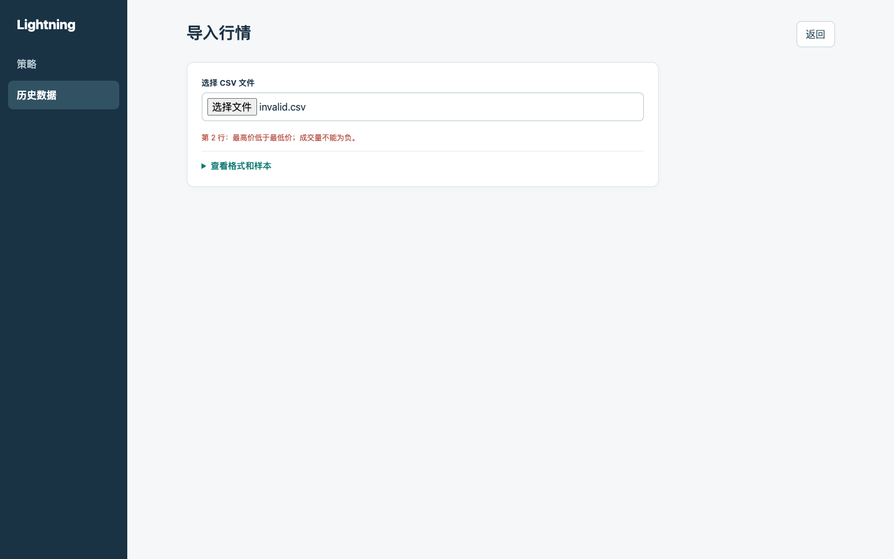</a>

`R-07` 已知交易时段内没有保存的行情时，图上留空，不补价格。周末等可确定的休市时间不计入“应有记录”；交易日历或停牌依据不足时，不推断缺少数量。

验收：已知范围中的空档可见；不能判断完整性时不声称完整或缺失。

`R-08` 对价格或成交量的明显变化给出“数据异常提示”，标记具体时点和观察到的变化。提示不要求使用者处理，也不代表价格一定错误。

验收：异常标记只出现在受影响时点，点击能看到原因。

### 3.4 保留旧版，供后续回测使用

`R-09` 每次成功补充或修正生成新版，包含数据集当时的全部行情。使用者可从导入记录看到版本承接关系和相关文件；旧版的行情、范围和异常提示保持不变。

`R-10` 本阶段不删除版本。旧版即使被回测引用，也持续可读取。

`R-11` 重启后，数据集、版本、原文件和异常提示仍可读取。备份存放在独立位置；恢复后核对版本、行情范围、数量和文件校验值。校验值用于系统验证文件，默认界面不展示。

`R-12` 后续回测按策略所需周期选数据集，检查目标股票和日期的行情、异常提示。提交时记录每个数据集的具体版本；以后导入不能改变旧回测引用的行情。回测选择页和阻止规则由 REQ-003 确定。

### 3.5 待确认

- 首批来源、股票、日期和文件格式；若来源明确限制使用，再按事实定规则。
- 交易日历、停牌、公司行为信息是否齐全；不足时只显示已保存行情。
- 其他分钟周期及盘前盘后是否有首期使用场景。
- 文件上限、存储容量和读取性能仍需按技术方案用真实样本验证。

交互设计步骤 6 自查：已逐项核对默认、空结果、失败和完成状态。查找页只问当前查找所需内容；股票可选可输，选中后只带入已有的交易所；K 线不重复逐条表格，长区间才显示滑杆，定位标记与读数一致；导入时不预选无依据的归属；无行情、异常和无效文件分开表述。原型行为仍需用首批真实文件和交易日历验证。
