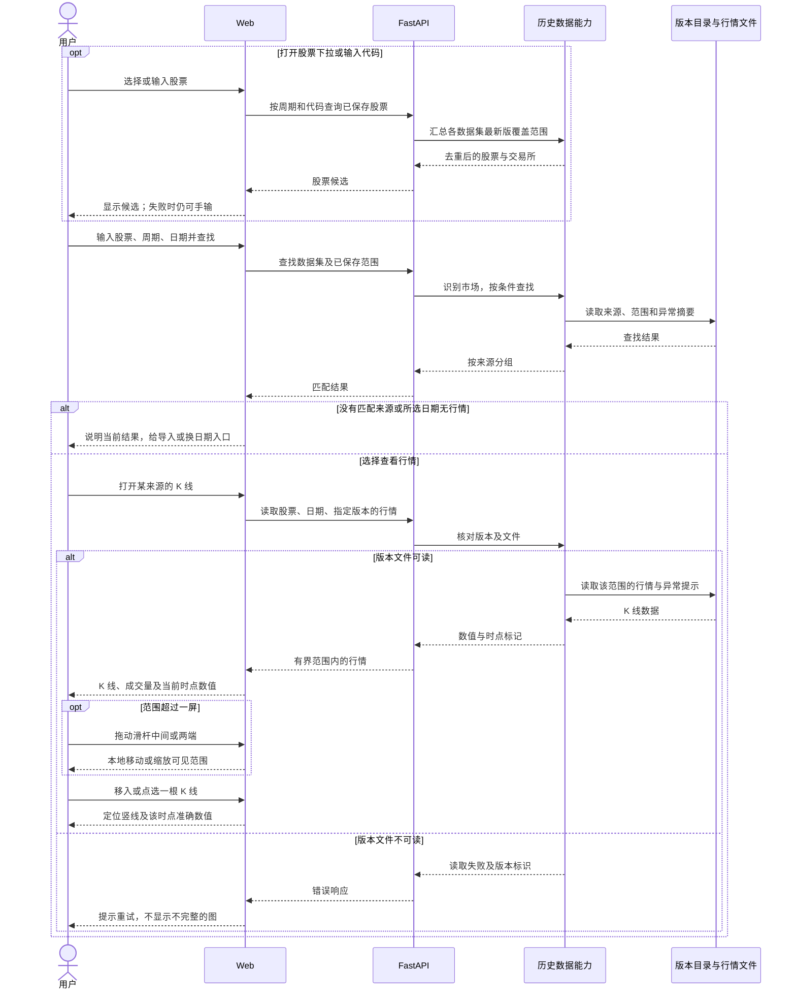
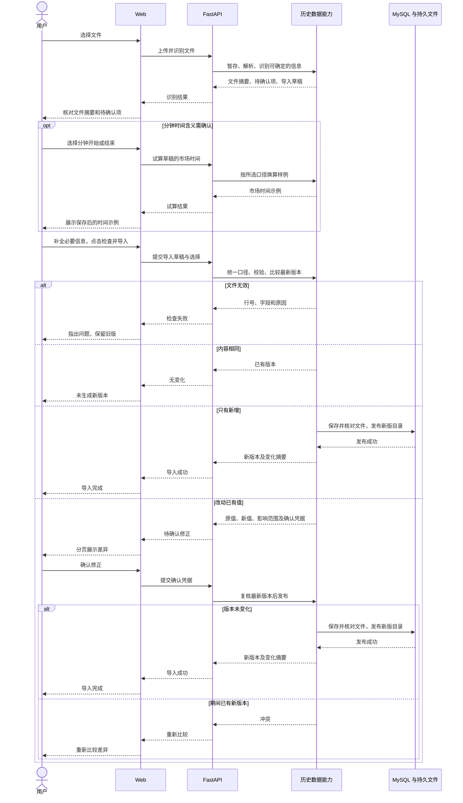

# 技术方案：历史数据

- 需求编号：REQ-002
- 状态：行情、K 线和股票下拉已实现；分钟线真实数据、来源口径与性能待验证
- 依据：[PRD](./prd.md) · [交互原型](./prototype.html) · [架构设计](./architecture-design.md)
- 方案日期：2026-10-24

## 1. 方案摘要

在现有管理台和 FastAPI 后端按股票、周期、日期查找行情，并提供 K 线查看和文件导入。股票可从已保存候选中选择，也可直接输入代码。后端将首期支持的日线、1 分钟 CSV 整理成统一行情；MySQL 保存来源、数据集、版本目录和异常提示，原始文件与不可变行情保存在本机持久文件中。两个存储部分完整后，才发布新版本。

行情文件使用 Parquet：它是按列保存表格的格式。当前先读取版本引用的文件，再筛选股票和日期；是否按股票和时间切分文件，待首批样本实测后决定。数据库与文件必须联合核对、备份。

本阶段不运行回测，也不建立数据权限管理或人工核实任务。后续回测只引用确定的数据集版本；选择页面和阻止规则由 REQ-003 决定。

## 2. 需求对应

| PRD 编号 | 实现做法 | 验证重点 |
| --- | --- | --- |
| `R-01`、`R-02` | 从各数据集最新版目录列出当前周期已保存的股票，按代码筛选并去重；选中时带交易所查找，手输代码仍可查。行情按指定版本读取；Web 用滑杆控制可见范围，缩放不聚合。 | 候选随周期和输入变化；同股跨来源不重复；候选失败不阻断手输。滑杆、定位和读数一致。 |
| `R-03`～`R-05` | 上传后先识别文件；由后端确定归属、比较变化。仅新增直接发布，修正旧值先确认。 | 目标不符、重复内容、多股票结果、并发修正和中断。 |
| `R-06`～`R-08` | 无效记录阻止导入；无行情留空；修正旧值给提示。一般价格和成交量变化仅在有经验证阈值时试验。 | 行号与原因准确；不推断无依据的缺口数量；未有真实样本与阈值时不宣称一般异常识别已验收。 |
| `R-09`～`R-12` | 版本引用完整的不可变行情与异常记录；数据库和文件一起备份。 | 旧版可读、隔离恢复后相同；未来引用固定版本。 |

## 3. 关键交互时序与接口

### 查找并查看行情

### 导入并生成版本

下表概括业务请求。正式路径、字段、状态码和错误模型由 FastAPI 与 Pydantic 定义，再导出 OpenAPI 供前端生成类型；遵循[接口协议规范](../../engineering/api-contract.md)。

| 场景与输入物 | 业务请求 | 检查重点 |
| --- | --- | --- |
| 周期与可选的代码片段 | 列出已保存股票候选 | 从各数据集最新版覆盖目录取代码、市场、交易所，跨来源去重；按代码筛选，限制返回量，不读取行情文件。 |
| 股票、周期、开始及结束日期；可选市场和交易所 | 查找来源及已保存范围 | 选中候选时按交易所精确查找；手输代码时不带交易所。日线按闭区间，分钟线为单日；不返回推测的缺口数。 |
| 数据集、股票、开始及结束日期、版本；分钟线可选时段 | 读取 K 线 | 日线返回区间内多根 K 线，分钟线为单日；仅返回所选范围的行情、准确数值及该版本异常提示；文件不可读时报错。 |
| 选择 CSV 文件；可带目标数据集 | 上传并识别 | 暂存原件，返回摘要、待确认项和草稿标识；目标不符时说明差异，不发布版本。 |
| 草稿与待确认的分钟时间含义 | 试算市场时间 | 在保存前返回换算示例；不改变数据集或版本。 |
| 草稿、来源和无法推断的口径 | 检查并导入 | 返回无效、无变化、已发布或待确认修正之一。 |
| 草稿、差异确认凭据 | 确认修正 | 复核比较所依据的最新版；变化时返回冲突。 |
| 草稿标识 | 查询处理结果 | 网络中断后确认是否已发布，避免重复提交。 |
| 某版本的导入来历 | 读取导入记录 | 沿版本承接链，按需返回该版包含的所有导入原文件名和时间。 |

股票候选需要新增只读接口；现有查找接口增加可选交易所参数。两者沿用[接口协议规范](../../engineering/api-contract.md)，无需修改已保存行情或数据库表。

## 4. Web 技术方案

页面沿用现有管理台入口，接口调用集中在 `web/infra/api.ts`，类型由 OpenAPI 生成。Web 可提前检查必填项、日期顺序和文件类型；数据归属、价格有效性、版本变化均以后端结果为准。

| 用户操作与页面反馈 | 前端逻辑与状态 | 接口请求及结果处理 |
| --- | --- | --- |
| 点开股票下拉或输入代码 | 候选随周期和输入变化；选中后记住代码、市场和交易所。手动改代码清除已选交易所；无候选或读取失败时仍可输入。 | 请求已保存股票候选；忽略过时响应，失败只影响下拉。 |
| 查找股票、周期、日期；显示来源和已保存范围 | 保留查询条件；可靠识别市场时不再询问。空结果按“无来源”或“该日期无行情”展示。 | 请求查找；选中候选时带交易所，手输时不带；失败后保留条件并可重试。 |
| 打开 K 线、切换日期或版本 | 默认最新版；短区间画全，长区间先画最近一段。日线只按已保存记录排列，不凭工作日推断缺口；分钟线在单日所选时段内可显示已知空档。异常另加标记。切换条件后重置可见范围与定位。 | 请求指定版本和日期的行情；失败不沿用另一版本的旧图。导入记录仅展开时读取。 |
| 拖动范围滑杆 | 超出一屏时才显示。中间移动，两端缩放；最少显示 8 个时点，最多显示当前宽度下仍可读的一屏。移动后原选中时点仍可见则保留，否则定位到可见的最后一根。 | 只使用已读取行情更新图表，不重复请求，也不把日线或分钟线合并成其他周期。 |
| 移入、点选 K 线 | 默认定位可见的最后一根；移入时临时显示竖线和数值，点击后固定并给整根 K 线描边，点击空白处取消固定。异常说明随对应时点显示；无行情与异常用不同标记。 | 直接读取当前版本返回的原始时点数值；选中态不改行情内容。 |
| 选文件；看到摘要和待确认项 | 上传后进入核对页；保留文件与已填选择。目标数据集不符时给“按文件另行导入”。 | 上传并识别；错误显示行号或文件问题。分钟时间含义变化时请求试算，保存前展示后端返回的市场时间示例。 |
| 点击“检查并导入”；看到失败、无变化或完成 | 禁止重复提交；根据结果进入纠错、已有版本或新版页面。多股票时先选要看的股票。 | 提交草稿；网络结果不明时先查询草稿结果，避免盲目重发。 |
| 修正旧值；看到原值和新值 | 分页看差异；只有显式确认才继续。返回核对页时保留选择。 | 提交确认凭据；版本冲突则重新比较，不复用旧差异。 |

## 5. 后端技术方案

后端沿用现有 FastAPI 入口和 SQLAlchemy 访问 MySQL。导入草稿只是暂存文件与选择，不是已发布版本；草稿超时或取消后可清理。所有影响保存结果的判断在后端重做。

| 接口接收与校验 | 业务处理及异常 | 模型、存储与返回结果 |
| --- | --- | --- |
| 候选周期与可选代码片段 | 校验周期，按代码筛选并限制数量；不按文件名或单一来源列股票。 | 读取各数据集最新版的覆盖目录，以市场、交易所、代码去重并排序；返回候选，不读取 Parquet 行情文件。 |
| 查找条件、可选交易所和时间范围 | 用股票及交易所识别市场；选中候选时只返回该交易所，手输时仍可返回多个交易所的结果。没有可靠交易日历时，只报告已保存范围。 | 从版本目录返回已保存范围；进入 K 线后才读取行情文件和该版异常提示。 |
| 文件上传 | 首期接受 UTF-8 CSV：日线用 `date`，分钟线用带时区的 `timestamp`；均需股票、开高低收价和成交量，`exchange` 可选。解析时限制大小，并逐行检查错误。 | 暂存原件并返回草稿、股票、条数、日期范围；能从 A 股代码确定交易所时自动识别，缺少美股交易所时要求选择；代码与显式交易所明显矛盾则拒绝。目标数据集市场或周期不符时立即提示。当前以 30 MB、20 万行作单次请求保护上限；实际容量阈值待首批样本确定。 |
| 草稿及归属选择 | 能确定的市场和交易所自动处理；不能确定的来源、价格处理、成交量单位、交易所或分钟开始／结束含义才请用户确认。复权数据还需方法和参照日期。美股仅接受“股”，A 股可用“股”或“手（100 股）”。现有目标的归类条件不可变；混合口径无法可靠分组时要求分开导入。 | 规范成统一行情后，按来源、市场、周期、价格处理方式和交易时段匹配数据集；不按文件名合并来源。 |
| 规范后的行情 | 检查时间、常规时段、周末、价格关系、成交量和同一时点冲突；错误返回行号、字段与原因。顺序可整理。 | 日线以交易所、股票、交易日期定位；分钟线以交易所、股票、分钟开始时刻定位。无效文件不产生导入记录或版本。 |
| 有效草稿与最新版 | 用精确十进制比较价格和成交量。完全相同返回已有版；仅新增可发布；改动旧值返回分页差异和确认凭据。 | 异常提示只记录观察到的价格或成交量变化及受影响时点；可配置的价格和成交量比率阈值与依据随版本固定；无真实样本前不预设生产阈值。不产生核实任务。 |
| 确认凭据及预期版本 | 重新核对草稿、差异与最新版；若期间已发布新版本，要求重新比较。重复确认或网络重试返回同一结果，不再生成版本。 | 新来源和数据集只在成功发布时建立。先写原件与新行情文件并核对，再一次提交版本目录、完整文件清单、异常记录和导入记录；失败不暴露半个版本。 |

**时间与数值。** 分钟时间先按文件时区和“开始／结束”含义换算成分钟开始时刻，再按股票所属市场判断常规时段；内部用 UTC（世界协调时间）保存时刻，展示时转回市场时间。美股夏令时用 [Python 时区规则](https://docs.python.org/3/library/zoneinfo.html)处理。成交量先按确认的单位换算；价格和成交量比较不用二进制浮点数。日期、时间和市场无法可靠判断时不猜测。

| 概念或关键属性 | 系统表示 | 关系与保存约束 |
| --- | --- | --- |
| 数据来源 | 稳定来源 ID；提供方与产品，或自有采集方式。 | 名称不是文件名；不同来源不自动合并。 |
| 数据集 | 稳定 ID；来源、市场、周期、价格处理方式、交易时段组成归类条件。 | 股票和日期只是覆盖范围；日线与分钟线分属不同数据集。 |
| 导入草稿 | 原件及草稿标识；处理状态和结果存 MySQL。 | 过期未发布草稿由停应用后的维护命令清理；仅删除无其他草稿或导入记录引用的原件。发布结果可按草稿标识查询。确认过期或比较依据变化时重算。 |
| 导入记录 | 成功导入的原文件、时间、所属数据集及变化摘要。 | 与生成的版本关联；内容完全相同不生成新记录或版本。 |
| 数据版本 | 稳定版本 ID、数据集内编号、前一版本、完整文件清单及异常记录。 | 每版代表当时全部行情；新增或修正只写变化部分并复用未变文件，旧版不可修改。 |
| 行情 | 交易所与股票、交易日期或分钟开始时刻、开高低收价和成交量。 | 原件单独保存；规范化行情写 Parquet。当前先读取版本引用的文件，再按股票和时间范围筛选；文件切分待真实样本实测。 |

版本目录记录文件校验值。写入采用“先完成并核对不可变文件，再提交可见目录”；中断留下的未引用暂存文件可清理，已发布文件不得因新版产生而删除。读取时发现目录引用的文件缺失或损坏，应报出版本读取失败并保留旧版目录。文件切分与校验的性能代价在样本验证后定。

数据库升级使用固定的 Alembic 建表定义，避免后续模型变化改写旧迁移。首次建卷的 MySQL 初始化脚本只授予应用查询、新增和更新权限；过期草稿清理使用停应用后的管理账号，不给日常应用删除权限。

## 6. 本机部署与数据保护

| 项目 | 做法与边界 |
| --- | --- |
| 持久化 | 在现有本机部署中增加行情文件持久卷；MySQL 继续保存目录。两部分缺一不可。 |
| 备份 | 扩展现有“停止应用再备份”命令，把数据库、原件、行情和校验清单作为同一批备份，放在数据卷之外。 |
| 恢复 | 先隔离恢复，核对数据集与版本关系、行情范围、条数和文件校验值；未通过不开放读取。 |
| 容量 | 用首批日线、分钟线样本实测文件大小、导入耗时、K 线读取与备份时间，再定切分、上传上限及空间预留。 |
| 来源限制 | 本期不做通用权限系统；若首批来源有明确保存或使用限制，先核对事实再确定接入方式。 |

## 7. 实施顺序与验证计划

| 步骤 | 可交付结果 | 验证与回退点 |
| --- | --- | --- |
| 1. 样本与口径 | 仓库演示样例可运行；首批来源、真实文件、价格处理、时间和成交量单位仍待明确。 | 用真实样本核对识别与转换；无法确定的口径不发布真实数据。 |
| 2. 后端存储与版本 | 数据集、草稿、不可变行情、比较和原子发布可用。 | 验证无效、重复、修正、并发、中断及旧版读取；发布失败不留下可见半版。 |
| 3. Web 与接口联调 | 股票下拉、查找、K 线、滑杆、核对导入、修正确认和空/失败/完成状态可用。 | 验证跨来源去重、周期切换、已选交易所、手输无候选、候选请求失败；再对照原型走 K 线与版本切换。按接口规范生成类型并联调。 |
| 4. 备份与性能 | 数据库和文件可联合备份、隔离恢复。 | 核对文件损坏、缺失、恢复失败和首批样本性能；不达标时保留原数据，调整切分或容量方案。 |

待首批样本确认：来源及其明确限制、股票与日期范围、文件列和时间含义、价格处理方式、交易日历/停牌依据、异常提示阈值。当前接口一次返回所选范围的全部行情；超长区间的读取时间与浏览器内存尚未实测，达不到要求时再定分段读取。缺少这些依据时，不声称行情完整或适合某次回测。实际验证结果见[测试报告](./test-report.md)。
