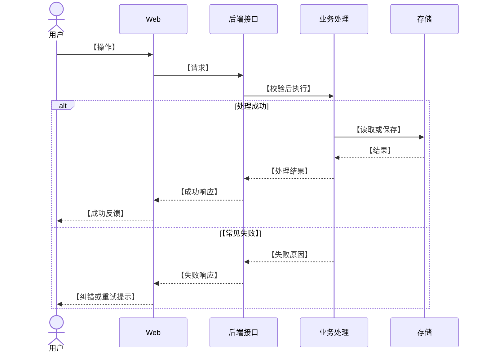

# 技术方案：【需求名称】

> 章节按 `docs/engineering/requirement-doc-structure.md`。只写本需求怎样实现、为什么这样选、怎样验证；不重复 PRD 和架构设计。

- 需求编号：【REQ-编号】
- 状态：草稿 / 已确认；实测结果另见测试报告
- 依据：[PRD](./prd.md) · [交互原型](./prototype.html) · [架构设计](./architecture-design.md)（不适用的链接删去）
- 方案日期：【YYYY-MM-DD】

## 1. 方案摘要

【几句话说清核心实现、本次边界。关键选型直接写理由、代价和待验证点，并链接决定性依据。】

## 2. 需求对应

| PRD 编号 | 实现做法 | 验证重点 |
| --- | --- | --- |
| `R-01` | 【涉及的模块、数据或接口】 | 【需核对的结果】 |

## 3. 关键交互时序与接口

【按 PRD 的关键使用场景画时序图。从用户操作开始，写到页面反馈；标明前后端请求、响应及会改变结果的常见异常。参与方按实际系统调整。】

| 场景与输入物 | 使用的接口或消息 | 正式定义与检查重点 |
| --- | --- | --- |
| 【对应 PRD 场景；文件等输入写格式】 | 【接口或消息名称】 | 【链接正式定义；写必要校验，不复制字段说明】 |

## 4. Web 技术方案

【按用户操作 → 前端逻辑 → 接口请求的顺序写。说明页面状态与反馈；前端校验帮助用户及时纠错，会影响最终保存结果的规则由后端判断。】

| 用户操作与页面反馈 | 前端逻辑与状态 | 接口请求及结果处理 |
| --- | --- | --- |
| 【入口、操作；加载/成功/失败时看到什么】 | 【选择、转换、临时校验、状态更新】 | 【何时请求；成功、失败、重试怎样处理】 |

## 5. 后端技术方案

【按接口接收与校验 → 业务处理 → 模型与存储的顺序写。说明权限、重复请求、冲突和中断的处理；多步内部处理难以看清时补流程图。】

| 接口接收与校验 | 业务处理及异常 | 模型、存储与返回结果 |
| --- | --- | --- |
| 【输入、权限、格式或规则校验】 | 【业务规则；重复、冲突、中断】 | 【读取/改变什么；如何保存；返回什么】 |

【沿用 PRD 的核心概念、延伸概念和贯穿例子。必要时区分业务模型与数据库表，不照抄 PRD 定义。】

| 概念或关键属性 | 业务含义与系统表示 | 关系、保存位置与变化约束 |
| --- | --- | --- |
| 【沿用 PRD 的名称】 | 【标识、取值或模型】 | 【何时产生、关联、更新或失效】 |

## 6. 【环境】部署与数据保护

【只写相关的运行环境、权限、容量、备份及恢复。标题可写成“本机部署与数据保护”等。】

## 7. 实施顺序与验证计划

【按可交付步骤写 Web、后端和联调验证；列出回退点及影响交付的待确认材料。实际执行结果另写测试报告，不把计划写成已通过。】
